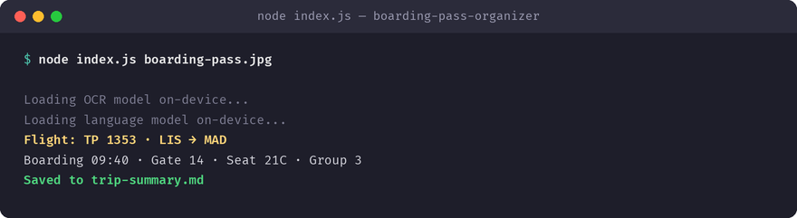

# boarding-pass-organizer

OCRs a boarding pass and extracts flight, gate, seat, and boarding time into a trip summary, on-device. Built with [Tether's QVAC SDK](https://github.com/tetherto/qvac) — the model runs on-device, so nothing leaves your machine.

## What it does

OCRs a boarding pass and extracts flight, gate, seat, and boarding time into a trip summary, on-device.

**QVAC functions used:** `loadModel`, `ocr` and `completion`.



## Why I built it

My boarding passes live in screenshots, emails, and one crumpled paper. I wanted one clean summary.

## Requirements

- Node.js >= 22
- `@qvac/sdk` `^0.19.0` (installed automatically via `npm install`)

## Install

```bash
git clone https://github.com/nafred001-code/boarding-pass-organizer.git
cd boarding-pass-organizer
npm install
```

## Run

```bash
node index.js path/to/boarding-pass.jpg
```

See the comments at the top of `index.js` for the exact input this app expects. On first run, QVAC downloads the model it needs once and caches it locally; every run after that is fully offline.

## SDK version used

`@qvac/sdk` `0.19.1`

## License

MIT — see [LICENSE](LICENSE).
